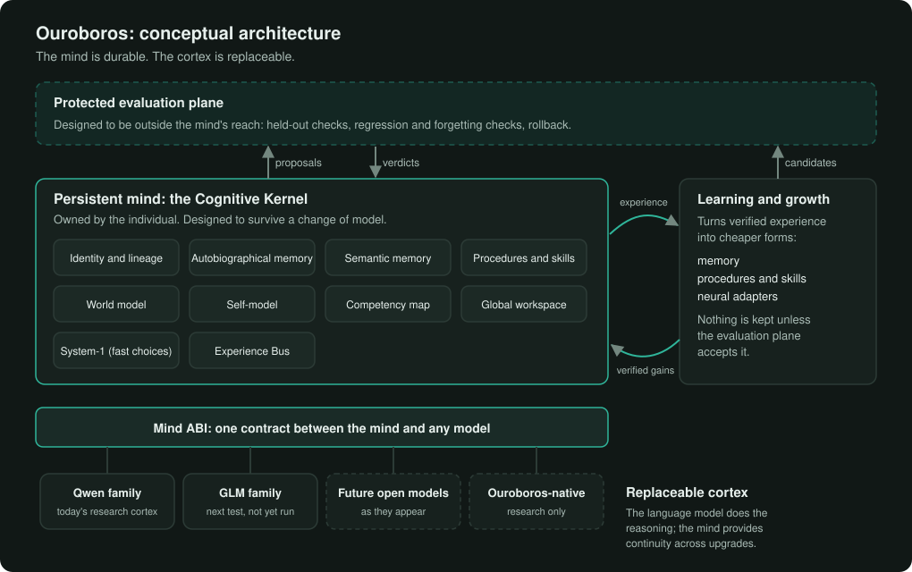
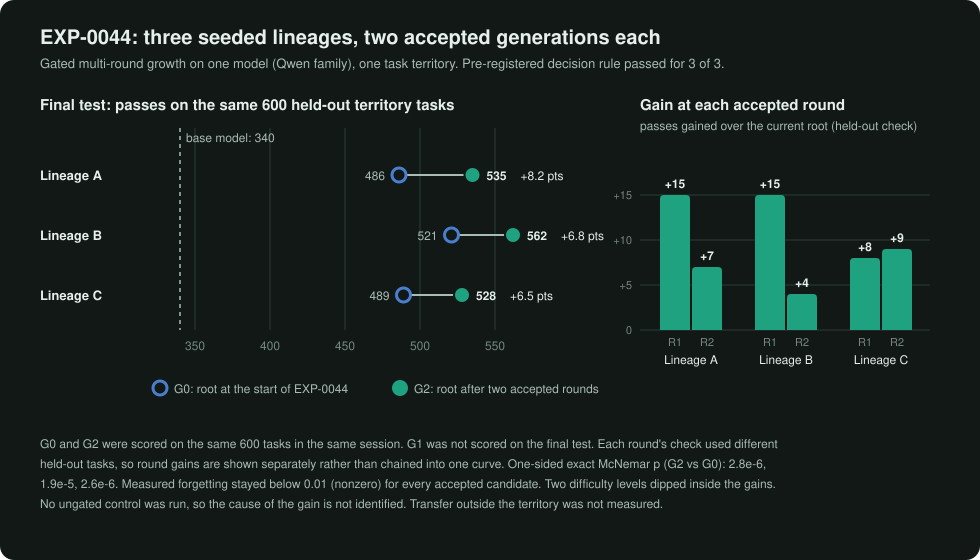
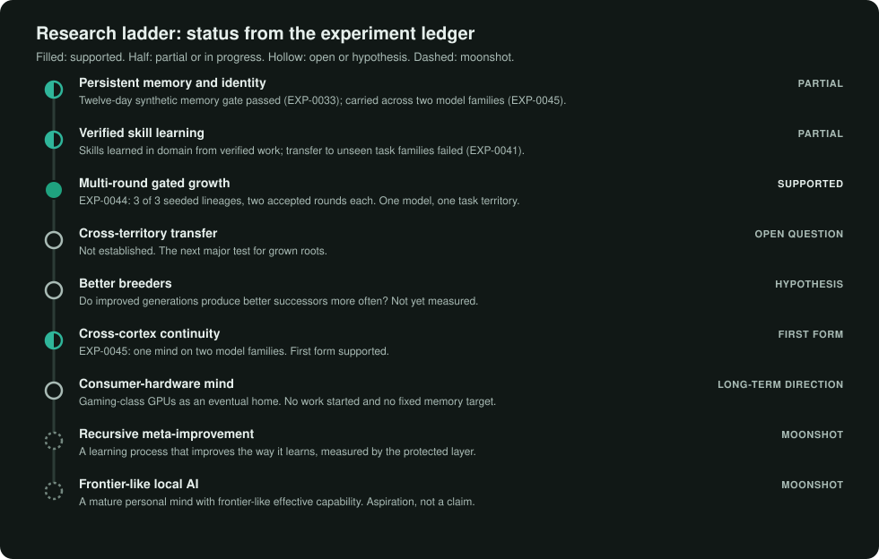

  

<h1 align="center">OUROBOROS</h1>

<strong>Research toward a lifelong, model-independent artificial mind</strong>

<em>The mind is durable. The cortex is replaceable.</em>

  Research Preview 0.1 ·
  <a href="results/EXP-0050.md">Latest result</a> ·
  <a href="results/EXP-0044.md">Growth result</a> ·
  <a href="EXPERIMENTS.md">Experiment ledger</a> ·
  <a href="ROADMAP.md">Roadmap</a> ·
  <a href="ODDS.md">Odds log</a> ·
  <a href="ARCHITECTURE.md">Architecture</a> ·
  <a href="PRIOR_ART.md">Prior art</a> ·
  <a href="#anchored-in-bitcoin">Bitcoin anchors</a> ·
  <a href="public-commitments/README.md">Public commitments</a> ·
  <a href="FAQ.md">FAQ</a>

Ouroboros is a research project exploring whether one persistent artificial intelligence can grow throughout its lifetime, become measurably more capable from verified experience, and preserve the same evolving mind while its underlying AI models are upgraded or replaced. Can an AI grow up instead of being replaced?

## Headline results

<table>
<tr>
<td width="50%" valign="top">

**EXP-0044 · Multi-round capability growth** 
SUPPORTED · strongest growth result

Three seeded skill lineages each finished two gated generations above their start on 600 held-out programming tasks: **+8.2, +6.8 and +6.5 points**, every p < 1e-4, forgetting below 0.01.

One model, one task territory. [Write-up](results/EXP-0044.md)

</td>
<td width="50%" valign="top">

**EXP-0045 · Persistent mind across model families** 
SUPPORTED (first form)

One mind moved from a Qwen-derived model to GLM-4.7-Flash and kept its identity, memory, procedures and calibration: continuity battery **15 of 15** on both models, against **1** for a newborn and **4** for a different genome.

Small test, no weights moved. [Write-up](results/EXP-0045.md)

</td>
</tr>
<tr>
<td colspan="2" valign="top">

**EXP-0046 · A neural skill without changing the mind** 
SUPPORTED (first form)

The mind asked for its own verified experience to be compiled into a small neural adapter on one model. With it, the mind passed **246 of 400** held-out tasks against **221** for the plain model (**+6.25 points**, p 0.0023); the plain model scored 230 on its repeat (+2.25). Its kernel code, identity, memories and other records stayed byte-identical; only promotion, training and registration records were added, and the second model never received the adapter.

Modest gain, one model, one round. [Write-up](results/EXP-0046.md)

</td>
</tr>
<tr>
<td colspan="2" valign="top">

**EXP-0047 · Brain migration** 
NOT SUPPORTED (first form)

The pre-registered migration decision was negative: the mind kept its lived history, kernel and records after moving from Seed-0 to Qwen3.8-27B, but lost capability. Its continuity battery scored **12 of 12** on both models, against **0 of 12** without the mind. The cache regrown from its records was harmful, so the quarantine rule refused it after its check. Rollback passed.

The continuity checks passed in this test; skills must be re-validated on the new model. [Write-up](results/EXP-0047.md)

</td>
</tr>
<tr>
<td colspan="2" valign="top">

**EXP-0048 · Skill regrowth after migration** 
PARTIAL

After moving to Qwen3.8-27B, the mind lived 300 new tasks and regrew a cache only from its verified passes there. The protected evaluator accepted it. On 400 held-out tasks, the regrown cache lifted the mind's frame from **293 to 351** (**+14.5 points**, p 1.3e-10) and beat the raw model's **326** by **+6.25 points** (p 0.0033). But the frame without the cache cost **8.25 points** against raw, so the frame-cost gate failed.

Skill regrowth carried across this model change. The remaining problem is the mind's working frame. [Write-up](results/EXP-0048.md)

</td>
</tr>
<tr>
<td colspan="2" valign="top">

**EXP-0049 · Validating the working frame** 
NOT SUPPORTED (first form)

The frame's five parts were tested in balanced combinations before the final test. The frozen rule removed the procedure and thinking/resources line, but kept the goal, self line and memories. On 400 held-out tasks, the validated frame scored **311** against **340** for the raw model. Its regrown cache raised it to **344**. In post hoc, ungated comparisons against raw, the validated-frame result was a tie and the old full frame with the same cache scored **359**.

The frame still costs the new model. The post hoc comparison is consistent with frame and skill co-adaptation. [Write-up](results/EXP-0049.md)

</td>
</tr>
<tr>
<td colspan="2" valign="top">

**EXP-0050 · Re-presenting the working frame** 
NOT SUPPORTED · latest result

On 800 fresh tasks, the new presentation scored **734** against a raw reference of **670.5**, and its regrown skill scored **744**. The skill added **+1.25 points** inside that presentation. But both regrown skills were refused in their 200-task quarantine checks. On 200 unseen tasks, the new presentation with its skill scored **141** against **156** for raw.

The re-presented frame with its regrown skill beat the raw model on familiar task families but regressed on unseen ones. Because the skill was refused in quarantine, this is the trained artifact's result, not the mind's. [Write-up](results/EXP-0050.md)

</td>
</tr>
</table>

**Not yet shown:** transfer outside the registered task families, a regrown skill that is accepted in quarantine and helps on unseen tasks, more than one training run per presentation, better breeders (generations that get better at producing successors), and recursive meta-improvement.

  

## Evidence dashboard

| | |
|---|---|
| **Pre-registered experiments** | 50: 14 supported, 8 partial, 18 not supported, 1 inconclusive, 9 infrastructure ([ledger](EXPERIMENTS.md)) |
| **Negative results** | All kept: every not-supported and inconclusive experiment is in the ledger with its outcome |
| **Running estimate** | 58 percent after EXP-0047, down from 61 after EXP-0046. A subjective estimate, not a statistic ([odds log](ODDS.md)) |
| **Latest result** | [EXP-0050](results/EXP-0050.md), re-presenting the working frame: not supported. The familiar-family gain did not hold on unseen families, and both regrown skills were refused in quarantine |
| **Cortex independence** | [EXP-0045](results/EXP-0045.md), one mind across two model families, first form: supported |
| **Strongest growth result** | [EXP-0044](results/EXP-0044.md), gated multi-round growth: supported in 3 of 3 lineages |
| **Built and first tested** | Mind ABI, Experience Bus, portable genome format, Cognitive Kernel v0 (tested together in EXP-0045) |
| **Public commitments** | Ledger checkpoint [entry 111](public-commitments/ledger-checkpoints.json), with 112 entries, published with this result; its OpenTimestamps proof is pending. [EXP-0050's reveal](public-commitments/experiments/EXP-0050.reveal.json) verifies four fields against its original commitment ([how it works](#anchored-in-bitcoin)) |
| **Next question** | Why did the regrown skill hurt unseen families and fail quarantine while the presentation alone helped on familiar families? Proposed; owner decision pending |
| **What we do not claim** | Not AGI. Not unrestricted self-improvement. We have no evidence that Ouroboros is sentient, and we make no such claim. |

### Known limits

- **Model-specific presentation and skills.** In EXP-0050, a new presentation helped on familiar task families, but its regrown skill was refused in quarantine and the combined artifact regressed on unseen families.
- **Narrow and short.** The growth result covers two rounds, inside one internally generated territory of programming tasks.
- **Transfer unmeasured.** Gains outside the trained territory were not measured, and an earlier transfer test was negative ([EXP-0041](EXPERIMENTS.md#exp-0041)).
- **Forgetting was measured, not zero.** It stayed below 0.01 on the forgetting probe for every accepted candidate. That does not rule out forgetting outside the probe.
- **Limited public auditability.** The ledger, task sets, training procedure, code and raw results are private. Hash commitments let some of it be checked later; see [what you can and cannot verify](#what-you-can-and-cannot-verify).

## Why this exists

Many AI assistants keep conversation state or external memory, and some systems already support persistent agents that can switch between models (see [PRIOR_ART.md](PRIOR_ART.md)). What usually does not carry over when the model changes is learned capability. Ouroboros asks whether verified behavioral capability, not only stored state, can grow over a lifetime and survive model replacement.

| Typical lifecycle | Ouroboros research lifecycle |
|---|---|
| Train a model | Install a persistent mind |
| Release it | Accumulate verified experience |
| Use it mostly as it shipped | Develop skills and measurable capabilities |
| Replace it when a better one appears | Upgrade the cortex, keep the identity and history, continue developing |

The right-hand column is the research goal, not a description of a working system.

## Core architecture

Four layers, kept deliberately separate. Detail: [ARCHITECTURE.md](ARCHITECTURE.md).

- **Persistent Cognitive Kernel.** The individual: identity, autobiographical and semantic memory, procedures and skills, a world model, a self-model, a map of measured competencies, a bounded workspace and a record of what it experiences. It is designed not to belong to any one model.
- **Mind ABI.** One contract between the mind and any language model, so the model can change without rewriting the mind.
- **Replaceable cortex.** The language model that does high-level neural reasoning. Today a Qwen-family open-weight model; next, a model from a different family.
- **Learning and growth plane.** Turns verified experience into cheaper, faster forms: memory, procedures, skills and, on open-weight models, small neural adapters. A protected evaluation plane outside the mind decides what is kept.

## Design hypotheses and evidence status

Most of these ideas exist in earlier work ([PRIOR_ART.md](PRIOR_ART.md)), and Ouroboros claims no novelty for mechanisms established by that work. What it adds is held to pre-registered measurement.

| Hypothesis | Status |
|---|---|
| A persistent individual with its own history and lineage | Partial: memory over a twelve-day synthetic run passed its gate; kernel built |
| A replaceable cortex: behavior and capability survive a model swap | Partial: identity, memory, procedures and calibration survived a swap between two families (EXP-0045). EXP-0050 found that a re-presented frame helped on familiar families, but the combined artifact regressed on unseen ones |
| Verified learning: changes are kept only when held-out checks say so | In use on one model (author-reported) |
| Capability compilation: recurring reasoning becomes cheaper skills | Partial: narrow skills learned; transfer not shown |
| Multi-timescale learning with different safeguards per speed | Partial: memory and adapter tiers exercised; slower tiers not started |
| Protected evaluation outside the learning system's reach | In use (author-reported; not externally audited) |
| Local deployment on hardware an individual owns | Long-term direction: no fixed hardware target; full per-generation resource records start with EXP-0046 |

## Latest result: EXP-0050

Classified NOT SUPPORTED. A frozen rule chose a presentation before the test. On 800 fresh tasks, it scored 734 against a raw reference of 670.5, and its regrown skill scored 744. Both regrown skills were refused in quarantine. On 200 unseen tasks, the combined artifact scored 141 against 156 for raw. General capability checks, the 12-of-12 identity battery, the selection rule and the unchanged stored mind passed. The re-presented frame with its regrown skill beat the raw model on familiar task families but regressed on unseen ones; because the skill was refused in quarantine, this is the trained artifact's result, not the mind's. The analysis program omitted that required prefix from its printed label, so the published label follows the registered text. EXP-0048 is not a full migration. The mind is durable. The cortex is replaceable. Skills and interfaces are translated or regrown for the cortex they inhabit. Full write-up: [results/EXP-0050.md](results/EXP-0050.md).

## Cortex independence: EXP-0045

One mind lived a session on a Qwen-derived model, was exported as a portable genome and imported onto GLM-4.7-Flash, a model from a different family. On a withheld 15-item continuity battery it scored 15 on both models, against 1 for a newly born mind and 4 for a different genome on the same GLM model. Every task frame on GLM carried its compiled procedure, and its predictions about its tools stayed calibrated (Brier 0.0032, against 0.0635 for the newborn). The held-out tasks were too easy to measure the effect of skills, and no learned weights moved. Full write-up, including what this cannot tell us: [results/EXP-0045.md](results/EXP-0045.md).

## Strongest growth result: EXP-0044

On one internally generated territory of programming tasks with automatic correctness checks, three seeded skill adapters ("roots") each went through two rounds of gated training. In each round a candidate replaced the current version only if it beat it on held-out tasks and passed a forgetting check. All three finished above where they started on a separate 600-task test. This did not test other task families or another model.

<table>
<tr><td>

**EXP-0044 · Gated multi-round growth · SUPPORTED**

*Can roots grow for two rounds, keeping a change only when it beats the current root?*

| | Lineage A | Lineage B | Lineage C |
|---|:---:|:---:|:---:|
| Accepted generations | 2 of 2 | 2 of 2 | 2 of 2 |
| Held-out territory tasks passed, start → final (of 600) | 486 → 535 | 521 → 562 | 489 → 528 |
| **Change** | **+8.2 pts** | **+6.8 pts** | **+6.5 pts** |
| One-sided exact McNemar p | 2.8e-6 | 1.9e-5 | 2.6e-6 |

**3 of 3** seeded lineages improved on the aggregate territory score · **2** successive accepted generations each · **600**-task final test · every **p < 1e-4** · no regression on the whole territory beyond base noise, though one difficulty level dipped in each of two lineages · forgetting measured **below 0.01** for every accepted candidate

**Next:** does it transfer outside the trained territory? Do better roots become better breeders?

</td></tr>
</table>

  

Three seeded lineages each completed two successive rounds of gated self-training. All three improved on the aggregate territory score, with no regression on the whole territory beyond base noise and with measured forgetting below 0.01; two difficulty levels dipped inside those gains. The next major questions are whether the gains transfer beyond the trained territories and whether improved generations become better at producing further improvements.

**What this shows**

- Under the EXP-0044 pipeline, a skill finished above its starting point after two successive accepted generations, in all three lineages.
- Each accepted generation served as the parent of the next round.
- No lineage repeated the aggregate regression seen in [EXP-0043](EXPERIMENTS.md#exp-0043), whose pre-registered decision was negative.

**What this does not show**

- **What caused the gain.** EXP-0044 had no matched ungated or old-data control, so it does not identify which part of the pipeline produced the improvement.
- **Transfer** outside the trained territory. Not measured here; an earlier test was negative.
- **Better breeders.** Two rounds do not show that later generations are better at producing improvements.
- **Duration.** Whether gains continue over many rounds is open.
- **Model independence.** All of this ran on one model, and the learned adapters are tied to its weights.
- **Recursive self-improvement** in any unrestricted sense. Ouroboros does not claim it.

Full write-up: [results/EXP-0044.md](results/EXP-0044.md).

## Research ladder

  

| Rung | Status | Evidence |
|---|---|---|
| Persistent memory and identity | Partial | Twelve-day synthetic memory gate passed ([EXP-0033](EXPERIMENTS.md#exp-0033)); kernel v0 built; carried across two model families in a first small test ([EXP-0045](results/EXP-0045.md)) |
| Verified skill learning | Partial | Skills learned in their own domain; transfer to unseen task families failed ([EXP-0041](EXPERIMENTS.md#exp-0041)) |
| Multi-round gated growth | Supported on one model, inside one territory | [EXP-0044](results/EXP-0044.md) |
| Cross-territory transfer | Open question | Not established |
| Better breeders | Hypothesis | Not yet measured |
| Cross-cortex continuity | Supported in a first small test | [EXP-0045](results/EXP-0045.md): two model families, one run; no weights moved |
| Neural learning without changing the mind | Supported in a first small test | [EXP-0046](results/EXP-0046.md): +6.25 points on one model (plain repeat +2.25); kernel and other records unchanged; second-model check weak |
| Brain migration | Not supported in a first small test | [EXP-0047](results/EXP-0047.md): continuity and rollback passed, but capability did not; harmful cache regrowth was refused |
| Skill regrowth after migration | Partial in a first small test | [EXP-0048](results/EXP-0048.md): regrown cache beat the stronger model alone, but the mind's frame-cost gate failed |
| Validated working frame | Not supported in a first small test | [EXP-0049](results/EXP-0049.md): the selected frame still cost the new model and was not activated |
| Re-presented working frame and regrown skill | Not supported | [EXP-0050](results/EXP-0050.md): the presentation helped on familiar families, but the combined artifact regressed on unseen families and both skills were refused in quarantine |
| Consumer-hardware mind | Long-term research direction | No fixed hardware target; full per-generation resource records start with EXP-0046 |
| Recursive meta-improvement | Moonshot | Not started |
| Frontier-like local AI | Moonshot | Not started |

## Open research questions

1. Do grown skills transfer outside the territory they were trained on?
2. Are later generations better at producing successful successors than earlier ones?
3. Do memories, identity and capabilities survive a change of model, measured by behavior rather than by stored files?
4. How much of a mature mind's capability can be compressed onto hardware an individual can own?
5. Can a world model and a self-model stay accurate when the model underneath them is upgraded?

More: [RESEARCH_QUESTION.md](RESEARCH_QUESTION.md).

## Anchored in Bitcoin

From EXP-0050 on, every public commitment, and from 2026-10-26 every ledger checkpoint, is submitted to [OpenTimestamps](https://opentimestamps.org). A proof becomes anchored in a Bitcoin block only after it confirms. Only a hash goes on the chain. The ledger, data and code stay private. Once a block confirms a hash, changing what it commits to after that block would be detectable, so confirmed anchors work as a tamper-evident public record that does not depend on trusting this repository or its author.

| Record | Bitcoin block (mined, UTC) |
|---|---|
| EXP-0050 pre-registration | 973045 (2026-10-25 08:55) |
| EXP-0050 amendment 1 | 973077 (2026-10-25 13:45) |
| EXP-0050 selection | 973088 (2026-10-25 15:21) |
| EXP-0050 amendment 2 | 973246 (2026-10-26 14:00), confirmed before its work started |
| EXP-0050 amendment 3 | 973311 (2026-10-26 23:53), confirmed before its work started |
| EXP-0050 amendment 4 | 973414 (2026-10-27 15:14), confirmed before its work started |
| [Ledger checkpoint at entry 108](public-commitments/checkpoint-history/ledger-checkpoints.seq108.json), covering EXP-0001 to EXP-0050 | 973290 (2026-10-26 21:04) |
| [Ledger checkpoint at entry 111](public-commitments/ledger-checkpoints.json), covering EXP-0001 to EXP-0050 | [Proof pending](public-commitments/ledger-checkpoints.json.ots) |

The first three proofs were submitted before the work they govern and confirmed after that work had begun, so for them the OpenTimestamps calendar receipt and the GitHub push time, not the block, show that they came first. From amendment 2 on, the work a commitment governs starts only after its block confirms. The entry-111 checkpoint proof is pending and is not yet confirmed in a Bitcoin block.

Each proof sits beside its file as `<name>.ots`. To check every proof against the Bitcoin block headers reported by two public block explorers, without running a node: `python3 public-commitments/anchors.py check public-commitments/experiments/*.ots public-commitments/ledger-checkpoints.json.ots`.

An anchor shows that a hash existed no later than the time its block was mined. It does not show how early the work began, it does not prove the private ledger is complete, and it does not make the ledger readable. Commitments before EXP-0050 rely on GitHub push times only. Details: [public commitments](public-commitments/README.md).

## What you can and cannot verify

The raw data, task sets, training procedure, code and the experiment ledger itself are private. Numbers on these pages are copied from that author-maintained ledger. Contamination checks and ledger integrity are author-reported. Pre-registration timing is author-reported for EXP-0001 to EXP-0045; from EXP-0046 on, each pre-registration is committed here by hash before it runs.

| You can | You cannot |
|---|---|
| Check internal consistency, for example that the EXP-0044 p-values recompute from the published gained and lost task counts | Reproduce any experiment from this repository |
| From EXP-0046 on, check that a revealed pre-registration field matches a commitment published before the run ([public commitments](public-commitments/README.md)) | Verify the pre-run timing of EXP-0001 to EXP-0045, which predate the commitments |
| See every experiment, including negative and inconclusive ones | Inspect the task sets, the training procedure or raw results |
| For each confirmed proof from EXP-0050 on, check that the corresponding commitment file or ledger checkpoint existed no later than the confirming Bitcoin block | Read what an anchored hash commits to before its fields are revealed |
| Test the claims independently on your own tasks and models | Rule out a trial run before a commitment; the author controls both the ledger and the timing |

Replication reports, positive or negative, are welcome: see [CONTRIBUTING.md](CONTRIBUTING.md).

## Hardware

Experiments run on a GX10-class (NVIDIA GB10) desk-side research workstation, which can serve and adapt a 35B-class open-weight model on one machine. The long-term aim is intelligence density: increasingly capable mature minds on practical hardware that individuals can own. No hardware ceiling is chosen in advance; each generation records its compute, memory, storage and latency, and the experiments will set the practical envelope. See [docs/consumer-hardware.md](docs/consumer-hardware.md).

## Research philosophy

**Ouroboros does not accept a change because the AI says it is better.** Experiments are pre-registered before they run. Hard, automatic checks come before model judges. A candidate replaces the current version only if it beats it on held-out tasks and passes a forgetting check. Regression and forgetting are measured against the evaluation's own noise. Negative results stay in the record. More: [docs/evaluation-philosophy.md](docs/evaluation-philosophy.md).

## Prior art

Ouroboros builds on earlier work, including [mini-AGI](https://github.com/volotat/mini-AGI), Letta and MemGPT, Enoch, Rosetta Memory, SEAL, AIDE², the Gödel Agent, the Darwin Gödel Machine, a self-improving coding agent, STaR and ReST-EM, PonderNet and adaptive computation, mixture-of-experts and continual-learning research, and indicator-based research on consciousness in AI. It claims no novelty for the mechanisms these works established. What each shows and how Ouroboros differs: [PRIOR_ART.md](PRIOR_ART.md).

## Follow the research

- **Discussions** (planned categories: Announcements, Experiment Discussion, Research and Papers, Architecture, Q&A) for questions, critiques and paper pointers.
- **Issues** for research questions, replication reports, prior-art references and documentation fixes. See [CONTRIBUTING.md](CONTRIBUTING.md).

The core implementation is private and does not accept outside code contributions. Research collaboration, independent replication, and strategic inquiries are welcome.

---

Ouroboros Research Preview 0.1, by Christopher Ayers. See [NOTICE.md](NOTICE.md) for what is and is not covered. Cite with [CITATION.cff](CITATION.cff).
